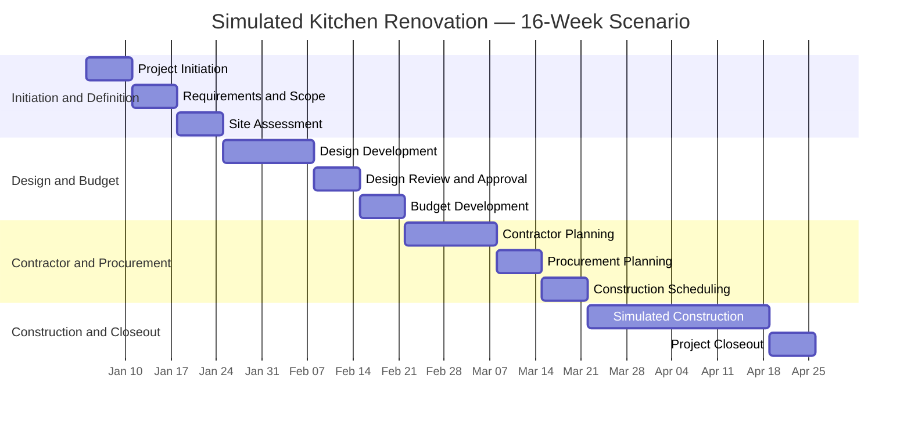

# Residential Kitchen Renovation — Visual Project Timeline

## Project Overview

**Project:** Simulated Residential Kitchen Renovation  
**Deliverable:** Preliminary Gantt Chart  
**Project Phase:** Planning  
**Status:** Illustrative schedule — not contractor-confirmed

## Timeline Summary

This timeline organizes the proposed renovation into sequential phases. It uses relative project weeks rather than calendar dates because contractor availability, site conditions, material lead times, and permit requirements have not been confirmed.

| Phase | Estimated Duration | Dependency |
|---|---:|---|
| 1. Project Initiation | 1 week | None |
| 2. Requirements and Scope | 1 week | Initiation |
| 3. Site Assessment | 1 week | Requirements and scope |
| 4. Design Development | 2 weeks | Site assessment |
| 5. Design Review and Approval | 1 week | Design development |
| 6. Budget Development | 1 week | Initial design |
| 7. Contractor Planning | 2 weeks | Scope and budget review |
| 8. Procurement Planning | 1 week | Design selections |
| 9. Construction Scheduling | 1 week | Contractor and procurement planning |
| 10. Simulated Construction | 4–6 weeks | Required approvals and readiness |
| 11. Project Closeout | 1 week | Construction completion |

**Planning estimate:** Approximately 15–17 weeks if these activities are completed sequentially. Some activities could overlap, while unforeseen conditions could extend the schedule.

## Visual Gantt Chart

The chart below shows an illustrative 16-week planning scenario. It uses a four-week construction allowance within the estimated 4–6-week construction range. It is not a committed completion schedule.

*The chart uses a hypothetical start date of January 4, 2027, solely to render a visual example. It is not an actual project start date.*

## Key Milestones

| Milestone | Target | Completion Evidence |
|---|---|---|
| Project Scope Defined | End of Week 2 | Requirements and scope documented |
| Site Assessment Completed | End of Week 3 | Existing conditions reviewed |
| Design Approved | End of Week 6 | Required design decisions documented |
| Budget Reviewed | End of Week 7 | Updated estimate reviewed |
| Construction Readiness Reviewed | End of Week 10 | Planning dependencies assessed |
| Construction Activities Completed | End of Week 14 | Work and outstanding deficiencies reviewed |
| Project Closeout Completed | End of Week 15 | Handover and closeout documentation prepared |

The milestone table represents the sequential phase durations above. The 16-week Gantt scenario includes an additional week in its hypothetical planning sequence; actual dates and milestones would be reconciled when the schedule is validated.

## Schedule Dependencies

Several activities depend on earlier decisions or deliverables:

- Design development depends on understanding the existing space and homeowner requirements.
- Budget refinement depends on design selections, material pricing, and contractor estimates.
- Procurement depends on confirmed selections and supplier availability.
- Construction readiness depends on contractor coordination and applicable approvals.
- Closeout depends on completion of work and resolution of outstanding deficiencies.

Changes to a predecessor activity may affect later milestones.

## Schedule Risks

The project manager should monitor:

- Delayed homeowner design decisions
- Material availability and delivery lead times
- Contractor scheduling conflicts
- Unexpected conditions discovered during demolition
- Permit and inspection requirements
- Approved scope changes

If a delay occurs, the project manager should evaluate its impact on dependent activities and communicate any necessary schedule changes.

## Schedule Monitoring Approach

The project manager would:

1. Compare planned dates with actual progress.
2. Track upcoming milestones and dependencies.
3. Identify delayed activities and their causes.
4. Coordinate recovery options with relevant stakeholders.
5. Document approved schedule changes.
6. Communicate revised expectations.

## Portfolio Reflection

This timeline demonstrates preliminary schedule development, sequencing, dependency identification, milestone planning, and schedule-risk awareness.

The chart is a simulated planning artifact. It does not represent an actual construction schedule or verified contractor commitments.

**Actual Construction Experience:** Not represented
