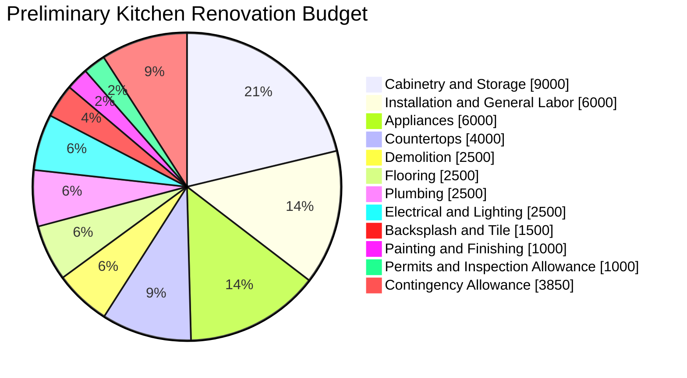

# Residential Kitchen Renovation — Visual Budget Breakdown

## Project Overview

**Project:** Simulated Residential Kitchen Renovation  
**Deliverable:** Preliminary Budget Visualization  
**Project Phase:** Planning  
**Budget Status:** Illustrative estimate — not contractor-verified

## Budget at a Glance

| Budget Measure | Amount |
|---|---:|
| Direct Project Costs | $38,500 |
| Contingency Allowance (10%) | $3,850 |
| **Preliminary Total** | **$42,350** |

The contingency allowance is calculated as 10% of the estimated direct project costs. All figures are simulated planning estimates, not verified market prices or an approved homeowner budget.

## Visual Budget Breakdown

The following chart compares the estimated direct costs of the renovation with the contingency allowance.

## Direct Cost Breakdown

| Cost Category | Estimated Amount | Share of Direct Costs |
|---|---:|---:|
| Cabinetry and Storage | $9,000 | 23.4% |
| Installation and General Labor | $6,000 | 15.6% |
| Appliances | $6,000 | 15.6% |
| Countertops | $4,000 | 10.4% |
| Demolition | $2,500 | 6.5% |
| Flooring | $2,500 | 6.5% |
| Plumbing | $2,500 | 6.5% |
| Electrical and Lighting | $2,500 | 6.5% |
| Backsplash and Tile | $1,500 | 3.9% |
| Painting and Finishing | $1,000 | 2.6% |
| Permits and Inspection Allowance | $1,000 | 2.6% |
| **Total Direct Costs** | **$38,500** | **100%** |

Percentages are rounded.

## Contingency Planning

The project includes a preliminary contingency allowance of $3,850.

A contingency provides a planning reserve for eligible, unforeseen project costs. It should not be treated as automatic spending authority or as a substitute for accurate estimates.

Potential cost pressures include:

- Hidden damage discovered during demolition
- Material price changes
- Additional labor requirements
- Approved design changes
- Unexpected site conditions

The project manager would monitor the reserve, document proposed uses, and obtain the required authorization before spending contingency funds.

## Budget Management Approach

The project manager would:

1. Establish an initial cost baseline after reviewing the scope and estimates.
2. Obtain contractor and supplier pricing.
3. Track estimated costs against actual and committed costs.
4. Document proposed changes and their financial impacts.
5. Review contingency usage and remaining funds.
6. Communicate budget changes to stakeholders.
7. Update the budget when changes are approved.

## Important Budget Assumptions

This preliminary budget has not been validated through a site visit, contractor bids, or supplier quotes.

The actual cost of a renovation depends on location, kitchen size, material selections, labor rates, existing conditions, and permit requirements.

Before this budget could be used for an actual project, the project manager would need to verify assumptions, clarify inclusions and exclusions, and obtain appropriate professional estimates.

## Portfolio Reflection

This deliverable demonstrates preliminary cost estimation, budget categorization, contingency planning, and visual communication of financial information.

It complements the project charter, work breakdown structure, schedule, risk register, and status report.

**Project Status:** Simulated planning  
**Actual Construction Experience:** Not represented  
**Budget Accuracy:** Not independently verified
